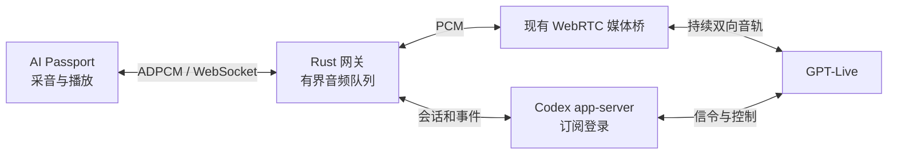

# GPT-Live 接入调研与畅聊改造方案

调研日期：2026-10-09。范围为公开文档、社区作者的项目说明、与服务器安装版本相同的 Codex `rust-v0.159.2` 源码，以及本项目代码。本文保留调研依据；后续 0.7.0 已按此方向改造，实际按键以 README 与 continuous.md 为准，真实语音效果仍由用户验收。

**决定：保留 ESP32-C3 + Rust 网关 + WebRTC 媒体桥 + Codex 订阅登录的接入架构；重做畅聊的收音和播放控制，让上、下行持续独立运行。** 开机仍默认按住 OK 说话，通过快捷菜单首项进入全双工畅聊。设备不承担完整 WebRTC、复杂模型或字幕渲染。

## 调研发现

### GPT-Live 与旧 Realtime 不能混用对话控制

当前官方文档把 GPT-Live 单独列为一套接口：前台语音模型负责持续交互，必要时委派后台模型处理较复杂的工作。迁移指南明确要求持续输入音频，由模型决定何时说话，不再沿用旧 Realtime 的手动音频提交和语音回复触发方式。静音也是音频时间线的一部分。

转写结束不等于扬声器播放结束。GPT-Live 没有旧式的每条语音回复完成事件供客户端据此切换收音；播放位置和积压需要客户端自己管理。应用仍可清理本地旧音频，但给模型追加控制指令的确认，也不能当作播放恢复确认。

来源：[GPT-Live 概览](https://developers.openai.com/api/docs/guides/live)、[迁移指南](https://developers.openai.com/api/docs/guides/live-migration)、[会话管理](https://developers.openai.com/api/docs/guides/live-conversations)、[服务端与播放控制](https://developers.openai.com/api/docs/guides/voice-server-controls?api=live)。

### 其他项目如何接入

| 项目 | 接入方式 | 对本项目的参考价值与限制 |
| --- | --- | --- |
| [Espressif openai_demo](https://github.com/espressif/esp-webrtc-solution/blob/main/solutions/openai_demo/README.md) | ESP32 设备上运行 WebRTC，使用 Opus、AEC，接公开 Realtime API | 可参考音频任务和传输设计；默认板卡为 ESP32-S3-Korvo-2，不能据此认定适合我们的 C3，也不能直接照搬旧 Realtime 的轮次控制。 |
| [ElatoAI / OpenAI Cookbook](https://github.com/openai/openai-cookbook/blob/main/examples/voice_solutions/running_realtime_api_speech_on_esp32_arduino_edge_runtime_elatoai.md) | ESP32-S3 经 WebSocket 连接边缘服务，再接 Realtime API | 说明轻量终端加网关的方式有实际先例；使用公开 API，不是 Codex 订阅语音路径。 |
| [esp32-arduino-webrtc](https://github.com/akdeb/esp32-arduino-webrtc) | 提供直接连接公开 GPT-Live 的示例 | 作者标注为早期原型，仅验证了 ESP32-S3；打包引擎支持 ESP32/S3，不含 C3。示例默认开启播放时的麦克风门控，因此默认无法在助手说话时插话。 |
| [gpt-live-1-demo](https://github.com/kylefu8/gpt-live-1-demo) | 浏览器 WebRTC 音轨加服务端会话创建，可接后台工具 | 可参考媒体与控制分离；使用公开 GPT-Live API 凭据，不是现有订阅账号路径。 |

这些项目的存在不是本设备性能或当前账号权限的验证。特别是“接上 GPT-Live”和“在扬声器播放期间保持收音”是两个不同的验收项目。

### Codex 同版本源码中的实现

本次只读核实服务器服务使用的 Codex CLI 为 `0.159.2`，按对应标签研究；未创建新的 GPT 语音会话。

- `thread/realtime/start` 的 v3 默认模型为 `gpt-live-1-codex`，使用 `FramelessBidi` 事件解析。模型允许配置覆盖，所以默认值不能替代实际会话确认。
- WebRTC 路径由媒体端产生 SDP，app-server 负责认证和会话创建，并通过旁路连接处理事件、上下文和后台工作。音频走媒体连接。
- 开源 TUI 的媒体实现使用独立的 `codex-voice-host`，包含 WebRTC、设备音频处理、Opus 与有界队列。控制管道传递信令、静音和扬声器抑制等信息，不传 PCM；它不是可以直接喂入 ESP32 音频的现成服务。
- TUI 对用户与助手的交错转写维护代次，必要时抑制旧播放，只有属于新输入的助手输出才恢复播放。麦克风静音和扬声器抑制是独立控制，不是播放时必须关麦。
- 该版本 v3 解析 `input_transcript.added`、`output_transcript.added`、`turn.done` 等事件。公开 GPT-Live 文档的事件命名与 Codex 订阅通道并不完全相同。
- app-server 的语音协议仍标注 EXPERIMENTAL，需要固定版本与协议适配层。以上是开源 CLI/TUI/app-server 的代码证据，不声称覆盖闭源桌面应用的全部内部实现。

一个影响选型的重要限制：此版本虽然声明支持 WebSocket 传输，但独立 WebSocket 语音启动调用 `realtime_api_key()`，缺少 API key 会报 `realtime conversation requires API key auth`。因此不能把已有 WebRTC 订阅会话直接改成 `appendAudio`，就认定可以省掉媒体桥且继续使用订阅。官方 Sign in with ChatGPT 的 app-server 示例描述的是 Responses 推理，也不能据此推导语音 WebSocket 已支持订阅。

源码与文档：

- [会话创建、默认模型与 WebSocket 认证](https://github.com/openai/codex/blob/rust-v0.159.2/codex-rs/core/src/realtime_conversation.rs)
- [WebRTC 呼叫创建](https://github.com/openai/codex/blob/rust-v0.159.2/codex-rs/codex-api/src/endpoint/realtime_call.rs)
- [v3 事件解析](https://github.com/openai/codex/blob/rust-v0.159.2/codex-rs/codex-api/src/endpoint/realtime_websocket/protocol_frameless_bidi.rs)
- [TUI 转写与输入代次](https://github.com/openai/codex/blob/rust-v0.159.2/codex-rs/tui/src/chatwidget/realtime.rs)
- [TUI 播放抑制与恢复](https://github.com/openai/codex/blob/rust-v0.159.2/codex-rs/tui/src/chatwidget/realtime/recording_controls.rs)
- [原生媒体控制协议](https://github.com/openai/codex/blob/rust-v0.159.2/codex-rs/realtime-webrtc/src/protocol.rs)
- [Voice host 实现范围](https://github.com/openai/codex/blob/rust-v0.159.2/codex-rs/voice-host/README.md)
- [实验性 app-server 语音协议](https://github.com/openai/codex/blob/rust-v0.159.2/codex-rs/app-server-protocol/src/protocol/v2/realtime.rs)
- [Sign in with ChatGPT 的 app-server 示例](https://developers.openai.com/siwc/token-sharing-open-source/codex-app-server)

## 当前项目的差距

代码已确认的行为：

1. `firmware/main/main.c` 和 `server/src/main.rs` 仍根据 `duplex` 设置，在半双工畅聊中随播放启停麦克风。
2. `server/src/conversation.rs` 用约 650 ms 静音判定播放段结束，并等待设备播放排空；打断后还要求约 200 ms 静音边界。这套控制参与全双工下行处理，可能延迟恢复或丢弃新回复。
3. `server/web/worker.html` 仅消费用户 `turn.started` 和 `turn.done`，没有完整利用当前 Codex v3 的增量转写事件。
4. `server/src/codex.rs::interrupt()` 实际追加一条要求停止说话的 developer 文本，自动插话也会触发它。它不是有严格完成语义的取消播放 API。

上述是代码事实；它们分别对用户每次卡顿贡献多少，尚未通过端到端时间线测量。不能把全部延迟归因于模型，也不能把所有问题归因于全双工。

此前的设备内存与 TCP 阻塞记录见 [性能诊断](performance.md)。其中的短时静音双向测试只验证传输与内存，不验证真实 GPT-Live 插话。全双工会增加同时收发的负载；内存是否持续增长取决于排队、释放及网络缓冲策略，不是全双工必然产生泄漏。

## 选定方案

**第一步：分开两种模式的控制。** 按住说话保留既有操作和上下文。通过快捷菜单打开畅聊后，麦克风和扬声器独立持续工作；助手开始说话、设备尚未播完、字幕结算均不得关闭麦克风。菜单暂停和用户主动停止仍可停止采音。畅聊不再需要另开一个“全双工”开关。

**第二步：让模型处理自然交互。** 畅聊持续送入音频，包括正常停顿。删除以本地静音时长和队列排空控制“下一轮可以开始”的逻辑。输出能量检测可保留给状态显示和节能，不得承担判断整条回答结束的职责。

**第三步：把自然插话和明确的按键打断分开。** 自然插话先采用持续音轨，让模型根据真实输入调整输出，不在每次听到用户时追加“立即停止”的文本。明确按键打断、切换会话时，立即清理服务器和设备的旧播放队列，并使迟到的旧帧失效。若进一步采用 Codex 的播放抑制策略，需要结合输入代次、交错转写和新输出归属恢复，不能照搬字幕角色切换，更不能用固定静音时间猜测恢复点。公开协议未提供足够归属信息时，不承诺客户端可以精确撤销所有模型上下文中的未播放音频。

**第四步：补全 v3 事件适配。** 将 app-server 和媒体端事件统一成一套会话状态，指定单一处理方，避免同一事件经旁路和数据通道重复执行。解析必要的增量转写和会话错误；文本只用于内存中的控制判断，不重新引入屏幕字幕、转写存档或长期记忆。未识别事件可记录类型，默认不记录音频、完整转写或凭据。

**第五步：按实际积压调整缓冲。** 保留现有 ADPCM 和固定内存上限，增加队列帧数、最老帧年龄、首帧到达、设备起播和清理完成的观测。当前设备预缓冲为 240 ms，容量上限为 640 ms；容量上限不等于始终存在的延迟。根据网络抖动逐步降低目标积压，不以无限加 buffer 解决卡顿；异常积压要有明确的过期和恢复策略，避免恢复网络后继续播很久之前的内容。

**第六步：保持接入稳定。** 继续由 Codex 处理账号认证，固定 `0.159.2` 协议适配。音色按该通道实际支持名单获取；不直接套用公开 API 的新音色。原生 Rust WebRTC 可作为后续替换媒体桥的独立工作，需要先解决 PCM 接入、节拍、编解码、抖动和生命周期，不能把它当作这次修好畅聊的前提。

此方案先解决现有功能语义，暂不加入唤醒词、文件管理、长期记忆或复杂账号体系。用户已经反馈当前没有明显回声，先保持持续收音；若实际出现回声误触发，再根据扬声器参考音频评估 AEC，不用默认关麦替代。

## 后续验收

离线检查覆盖模式切换、交错转写、清理后迟到帧、队列边界、异常关闭和恢复。真实语音由用户验证：助手说话时麦克风仍在上传；明确插话后不继续播旧回答；短应声不会让会话卡住；长句和自然停顿不被截断；连续聊多轮不越来越迟；按住说话仍保持默认行为。

对响应慢要分别记录松手或语音停顿、网关送入、模型首音、设备起播时间。网络往返延迟、模型响应和本地排队分开判断，不承诺未经实测的端到端毫秒数。
